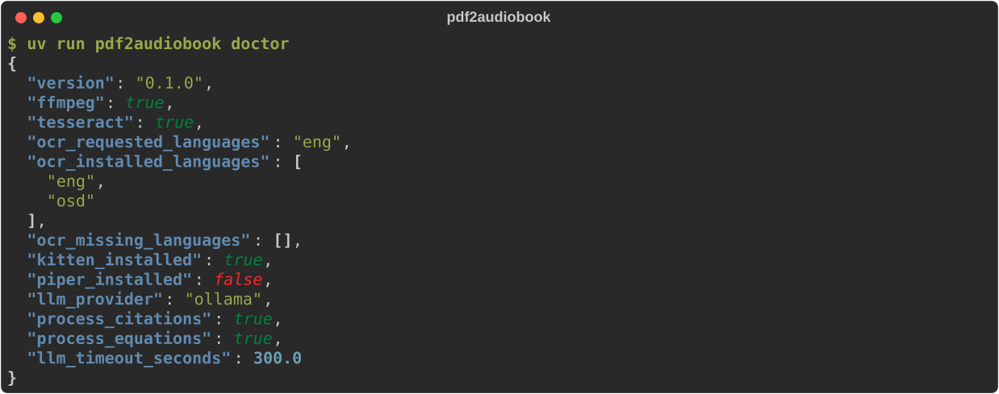
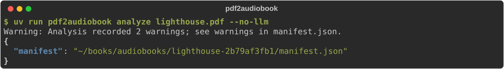
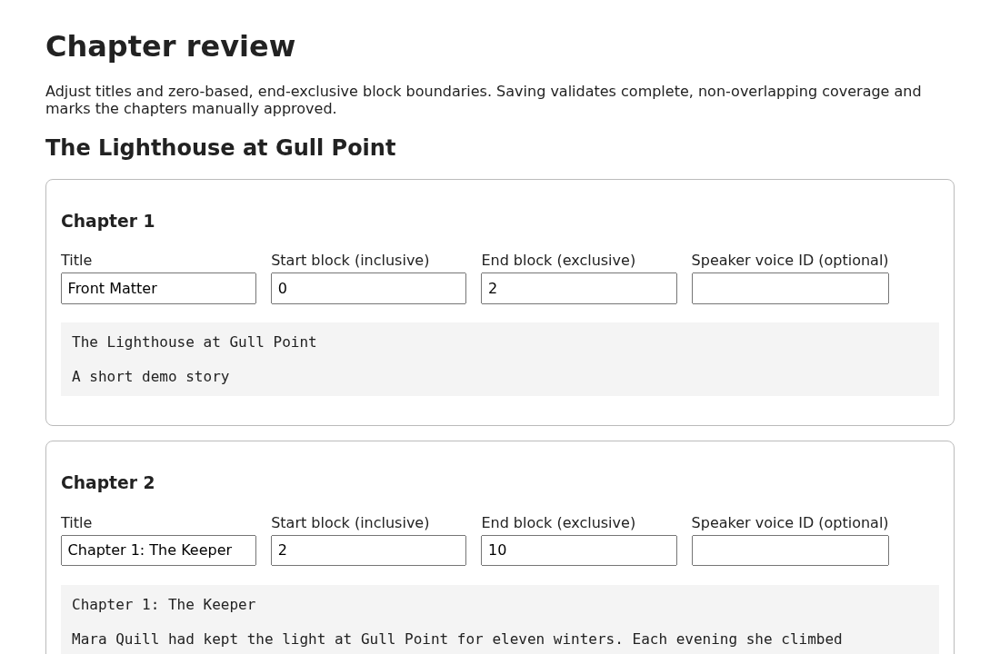
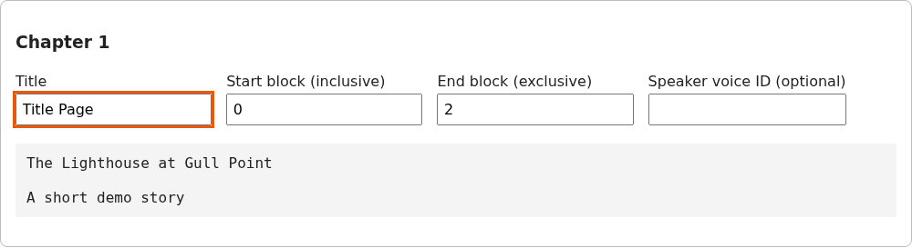
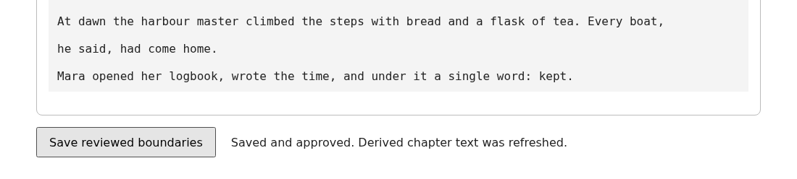
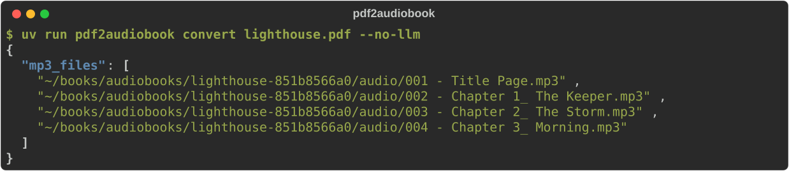
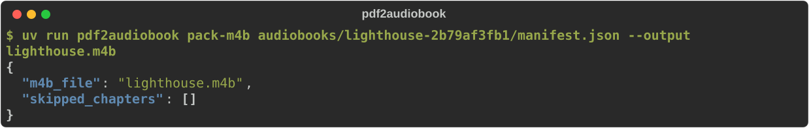

# pdf2audiobook

pdf2audiobook turns a PDF or EPUB book into an audiobook: one tagged MP3 per chapter, which you
can also package as a single M4B file with chapter navigation. It works offline by default.

It reads the book's text (using OCR for scanned pages), removes page numbers, headers and
footers, and splits the text into chapters. You check the chapters in a small browser page, and
then a local text-to-speech voice reads each chapter aloud. A local LLM can optionally help: it
finds chapter structure, suggests cleanups for OCR errors, flags captions and tables for
review, and proposes spoken readings of equations. The LLM's suggestions are only proposals, and
nothing it suggests reaches the audio until you approve it.

**Status:** Working CLI with offline end-to-end fixture coverage. Real Kitten synthesis is an opt-in smoke test; live OpenAI and llama-server acceptance remains deferred. See the [specification](docs/PDF2AUDIOBOOK_SPEC.md), [implementation TODO](docs/PDF2AUDIOBOOK_TODO.md), and [installation/maintainer guide](docs/MAINTAINER_GUIDE.md).

**Contents:**
[Requirements](#requirements) ·
[Development setup](#development-setup) ·
[Linting and tests](#linting-type-checking-and-tests) ·
[Walkthrough](#walkthrough-from-pdf-to-audiobook) ·
[Using a local LLM](#using-a-local-llm-ollama) ·
[Command reference](#command-reference) ·
[Voices](#voices-and-speech) ·
[Editing chapter text](#editing-chapter-text) ·
[Exit codes](#exit-codes)

## Requirements

| What | Needed for | Notes |
|---|---|---|
| [uv](https://docs.astral.sh/uv/) and Python 3.11+ | Everything | uv installs Python and manages `.venv` for you. CI tests 3.11, 3.12 and 3.13. |
| FFmpeg | Making MP3 and M4B files | Install with your OS package manager, for example `sudo apt install ffmpeg`. |
| Tesseract (`eng` pack) | Scanned pages (OCR) | For example `sudo apt install tesseract-ocr tesseract-ocr-eng`. Text PDFs don't need it. |
| Kitten TTS | The default voice | A Python extra: `uv sync --extra kitten`. The first conversion downloads the model. |
| Ollama | Optional LLM assistance | Not needed with `--no-llm`. See [Using a local LLM](#using-a-local-llm-ollama). |
| Node 22 | A few page-script tests | Those tests skip when `node` isn't installed. |

Piper is an alternative voice that you install separately; see [Voices and speech](#voices-and-speech).

## Development setup

~~~bash
git clone <this repository> pdf2audiobook
cd pdf2audiobook
uv python install 3.11
uv sync --locked --extra kitten --extra dev   # app, voice model support and dev tools
uv run pdf2audiobook doctor                   # checks FFmpeg, Tesseract, Kitten and the LLM settings
~~~

`uv sync` creates and manages `.venv` automatically; run everything through `uv run` and never
install into the system Python. If you don't need real speech (for example, to work only on
analysis code), `uv sync --locked --extra dev` is enough and much smaller: the tests mock the
voice. The `kitten` extra pulls in a large model stack and downloads the voice model on first use.

**Lockfile:** The generated `uv.lock` is committed and pins the project's declared default, `dev`, and optional `kitten` dependency graphs. For reproducible development installs, run `uv sync --locked --extra dev`; for the heavyweight voice extra, run `uv sync --locked --extra kitten --extra dev`. Regenerate the lockfile deliberately with `uv lock` when changing dependencies and review the resulting diff. **CI verifies `uv lock --check` and installs development dependencies using `uv sync --locked --extra dev`** on Python 3.11, 3.12 and 3.13; the optional Kitten model remains an explicit heavyweight, environment-dependent acceptance gate.

Note that `uv sync --locked --extra dev` *removes* the Kitten packages if they were installed;
add `--extra kitten` again before converting a book.

## Linting, type checking and tests

These are the same checks CI runs (`.github/workflows/ci.yml`). Run them all before committing:

~~~bash
uv lock --check                        # the lockfile matches pyproject.toml
uv run --extra dev ruff check .        # lint, including import sorting
uv run --extra dev ruff format --check . # formatting (use `ruff format .` to fix)
uv run --extra dev mypy                # type check the files listed in pyproject.toml
uv run --extra dev pytest -q -ra       # the full test suite, with a summary of skips
~~~

- **Formatting:** `uv run --extra dev ruff format .` rewrites files in place;
  `ruff check --fix .` fixes import order.
- **Type checking:** CI runs mypy once per Python version. To match it, also run
  `uv run --extra dev mypy --python-version 3.12` and `--python-version 3.13`. When you add a
  module under `src/`, add it to `[tool.mypy].files` in `pyproject.toml`.
- **One test file or test:** `uv run --extra dev pytest tests/test_review_ui.py -q`, or add
  `-k name` to select by name.
- **Skipped tests:** tests that need FFmpeg, Tesseract or Node skip when the program is missing.
  Read the `-ra` summary at the end of the run to see what was skipped and why.
- **No network:** the test suite never needs the network or a running LLM. Live LLM checks are
  separate and opt-in (see [the smoke tests](#opt-in-live-llm-provider-smoke-tests)).

CI also runs a CLI smoke test (`--help`, `config show --json`, `doctor --json`) and installs the
built wheel and sdist into a clean virtual environment.

## Walkthrough: from PDF to audiobook

This example converts a short four-page demo book, `lighthouse.pdf`, without an LLM. Every
screenshot is real output from the commands shown. Book workspaces are created under
`./audiobooks/` in the folder you run from; each book gets its own folder, named after the file
plus a short hash.

### Step 1: Check your setup

~~~bash
uv run pdf2audiobook doctor
~~~



Check that `ffmpeg` and `kitten_installed` are `true`, and that no OCR language is missing. If
Kitten shows `false`, run `uv sync --extra kitten --extra dev`.

### Step 2: Analyze the book

~~~bash
uv run pdf2audiobook analyze lighthouse.pdf --no-llm
~~~



Analysis extracts the text and writes a workspace with `manifest.json` (the chapters, the source
text and every warning) and one editable text file per chapter in `chapters/`. It makes no audio.
You can skip this step and go straight to `convert`, which analyzes first if needed.

### Step 3: Convert, and see why it stops

~~~bash
uv run pdf2audiobook convert lighthouse.pdf --no-llm
~~~


Conversion refuses to make audio while any chapter boundary is uncertain. Here the title page
became a "Front Matter" chapter with low confidence, so the run stops with exit status 6 and
asks you to review. Nothing has been synthesized yet.

### Step 4: Review the chapters in your browser

~~~bash
uv run pdf2audiobook review audiobooks/lighthouse-3c5f49c9a4/manifest.json
~~~


Open the printed address. The page lists every chapter with its title, its block range and a
preview of its text:



Fix what is wrong. Here chapter 1 only holds the title page, so give it a better title. You can
also move a chapter's start and end block (blocks are numbered from 0, and the end is
exclusive), or set a different voice for a chapter:



Scroll to the bottom and click **Save reviewed boundaries**. Saving checks that the chapters
cover every block exactly once with no overlap, marks them all as manually approved, and
rewrites the chapter text files:



Press Ctrl+C in the terminal to stop the review server. The server listens only on
`127.0.0.1` and uses a fresh access token each run.

The review page can retitle chapters and move boundaries, but it can't add or remove chapters.
To merge or split chapters, edit the `chapters` list in `manifest.json` (keep a backup), then
see [Protecting manual edits](#protecting-manual-edits).

### Step 5: Convert again

~~~bash
uv run pdf2audiobook convert lighthouse.pdf --no-llm
~~~



The analysis is reused, and each chapter becomes a tagged MP3 in the workspace's `audio/`
folder. A long book shows a progress bar with a time estimate in an interactive terminal (see
[Progress and time estimates](#progress-and-time-estimates)). If a run is interrupted, run the
same command again: finished chapters are kept.

### Step 6: Package as one M4B (optional)

~~~bash
uv run pdf2audiobook pack-m4b audiobooks/lighthouse-3c5f49c9a4/manifest.json --output lighthouse.m4b
~~~



The M4B holds all chapters with chapter markers, which most audiobook players show as a
chapter list. Add `--cover cover.jpg` for artwork.

### What to check before you share an audiobook

Chapter detection, tables and figures are still the weak spots, especially in technical papers.
Before you share the files, read `chapters/*.txt` or listen to the chapters, and check the
warnings in `manifest.json`: tables are read cell by cell, and words drawn inside figures can
appear as loose words. Put such material in its own chapter at review time, so listeners can
skip it.

## Using a local LLM (Ollama)

LLM assistance is on by default and uses Ollama on `127.0.0.1`. Book text never leaves your
machine unless you choose a remote provider and pass `--allow-remote-content`.

1. Install [Ollama](https://ollama.com) and pull a model, for example `ollama pull qwen3.5:9b`.
2. **Give the model a large enough context.** Before uploading any text, pdf2audiobook asks Ollama
   what context the model really serves, and refuses the run if a request would not fit ("LLM
   request exceeds the context length the Ollama server serves"). A plain model tag often has
   a small default context, so create a variant with a larger `num_ctx`:

   ~~~bash
   printf 'FROM qwen3.5:9b\nPARAMETER num_ctx 262144\n' > Modelfile
   ollama create qwen35-256k -f Modelfile
   ~~~

3. **Allow room for reasoning.** Thinking models such as qwen3.5 spend output tokens on reasoning
   before they answer. The default cap of 1024 is too small for them ("LLM answer was cut off at
   the output cap"); use 32768.
4. Convert with those settings:

   ~~~bash
   uv run pdf2audiobook --heartbeat 60 convert book.pdf \
     --llm-model qwen35-256k:latest --llm-context-tokens 262144 --llm-output-tokens 32768
   ~~~

   The book is sent in windows of about 4,000 bytes (`llm.chunk_tokens`), never all at once.
   Each window also needs room for the output cap, so the served context must be larger than
   the output cap plus the window. `--heartbeat 60` prints a status line every minute. As a
   rough guide, a 15-page paper took about 100 requests and 7 minutes on a 16 GB GPU.

5. **Approve the LLM's proposals.** Proposed cleanups and equation readings are stored as
   *pending* edits and are not used until you accept them:

   ~~~bash
   uv run pdf2audiobook edits list audiobooks/BOOK/manifest.json
   uv run pdf2audiobook edits accept audiobooks/BOOK/manifest.json --all
   ~~~

   Then run `convert` again to regenerate the affected chapters. See
   [Citations and equations](#citations-and-equations).

Put settings you use every time in `~/.config/pdf2audiobook/config.toml` instead of repeating the
flags; `uv run pdf2audiobook config show --sources` shows the effective settings and where each
came from:

~~~toml
[llm]
max_context_tokens = 262144
max_output_tokens = 32768

[llm.ollama]
model = "qwen35-256k:latest"
~~~

The default LLM provider is local Ollama; OpenAI requires explicit consent before transmitting book contents. For consented non-loopback endpoints, a one-time stderr warning identifies the provider, selected model, and current analysis block-window scope *before* uploading book text. Local loopback analysis does not emit the remote-upload warning. See the specification for privacy and audit requirements.

## Command reference

~~~bash
uv run pdf2audiobook doctor
uv run pdf2audiobook config show --sources
uv run pdf2audiobook inspect path/to/book.pdf
uv run pdf2audiobook analyze path/to/book.pdf --no-llm
uv run pdf2audiobook convert path/to/book.pdf --no-llm --allow-single-chapter
uv run pdf2audiobook batch ./books --no-llm --recursive
uv run pdf2audiobook pack-m4b ./audiobooks/BOOK/manifest.json --output ./book.m4b
uv run pdf2audiobook convert path/to/book.pdf --cover ./cover.jpg
uv run pdf2audiobook convert path/to/damaged.pdf --accept-review damaged_source
uv run pdf2audiobook budget show --output ./audiobooks/BOOK
uv run pdf2audiobook convert path/to/book.pdf --llm-provider openai --allow-remote-content
~~~

Every command has `--help` with its options and an example.

`analyze` extracts text, applies conservative pagination cleanup and writes chapter text plus a manifest. `convert` additionally creates tagged chapter MP3s with the selected TTS provider; `--cover PATH` embeds JPEG/PNG artwork (up to 5 MiB). The same option works with `batch`, and `audio.cover_image` configures a default. `pack-m4b --cover` applies artwork to the M4B only; packaging freshness is based on chapter text. `budget show` reports content-free LLM request accounting; unknown and pending attempts count at their worst-case token and cost bounds. A rejected provider request still counts toward `max_requests`, but does not consume token or cost budget when it reports no usage. `budget resolve` settles an ambiguous request only after explicit confirmation. TTS retries default to two and are limited to transient failures; failed chapters are visible with `inspect`, and conversion continues through other chapters before reporting partial failures. Use `--accept-review REASON` only after reviewing a book-wide issue; the accepted codes are `damaged_source` and `ambiguous_page_numbers`. An unknown code exits 2 before any work, and `--dry-run` reports what it would acknowledge. Empty chapters are per-chapter: approve that chapter in the browser review page (`review`) before conversion. An approved empty chapter is skipped and listed in the conversion report. `--accept-review empty_chapter` exits 2; approval of one chapter never approves a different chapter that becomes empty later. Budget rows without a recorded bound (from older ledgers) block token and cost budgets until `budget resolve` settles them. A failed command prints only its `Error:` line (or one JSON object with `--json`). JSON results include a `warnings` array of warning event codes; human mode renders `Warning:` lines. `--quiet` suppresses warnings and progress, while progress and failure events appear on stderr only with `--verbose` or an explicitly configured `general.log_level`. A second `convert` of the same book is refused while one is running.

Install Tesseract separately for scanned pages. For synthesis, run `uv sync --extra kitten --extra dev` and install FFmpeg. The Kitten model alias `mini` resolves to the lightweight 0.8 mini model.

**Limitations:** Chapter detection is provisional, especially for complex layouts. A poem or section-number sequence in the only qualifying margin band can be mistaken for folios; disable removal with `pdf.remove_page_numbers = false` if needed. Tables, footnotes, OCR ambiguities and LLM-assisted text corrections remain in progress. Review chapter text before distributing audiobook files.

### Exit codes

| Code | Meaning |
|---|---|
| 0 | Success |
| 1 | Unexpected error |
| 2 | Invalid configuration or command-line usage |
| 3 | Unreadable or unsupported input (for example a wrong PDF password) |
| 4 | Extraction or workspace problem (for example a chapter-edit conflict or a pending recovery) |
| 5 | LLM problem (unreachable server, context too small, output cut off, budget reached) |
| 6 | Audio problem, including "review the manifest before synthesis" |
| 7 | Some chapters converted and others failed |
| 130 | Interrupted with Ctrl+C |

### PDF and EPUB input

PDF and EPUB books use the same analysis commands. For an EPUB, chapter boundaries come from its
own outline when it has one: an entry such as "Chapter 12" is matched to the line that opens that
chapter on its page, including books whose chapters begin with only a numeral. Cover and plate
pages that are just an image are noted but do not block conversion, and an EPUB's many per-page
warnings are summarized as one line with a count ("Analysis recorded N warnings; see warnings in manifest.json"). Page numbers in an EPUB are generated by
the renderer and can vary.

### Batch conversion

Batch conversion accepts a directory of PDFs (nested folders are opt-in):

~~~bash
uv run pdf2audiobook batch ./books --no-llm --recursive --json
~~~

## Voices and speech

Kitten is the default TTS provider. Piper can be selected when its CLI and a voice model are installed separately; configure the ONNX model path in TOML:

~~~toml
[tts]
provider = "piper"

[tts.piper]
model_path = "/path/to/en_US-lessac-medium.onnx"
voice = "0" # optional multi-speaker ID
speed = 1.0
~~~

Then run `uv run pdf2audiobook convert book.pdf --no-llm --tts-provider piper`. Piper is not installed or downloaded by the default project environment.

Use `tts.profiles` to select a voice and speed by exact PDF filename stem:

~~~toml
[tts.profiles."My Book"]
provider = "kitten"
kitten_model = "mini"
voice = "Jasper"
speed = 1.05

[tts.pronunciations]
"Māori" = "Mow-ree"
~~~

Pronunciation replacements apply only to speech output; they must be a single token. Source chapter text remains unchanged and progress ranges still point to the original words.

For dialogue, edit an approved chapter text file and put `[[voice:VOICE_ID]]` on its own line between blank lines before the paragraph that voice should narrate. For example:

~~~text
The narrator introduces the scene.

[[voice:OtherVoice]]

“We should leave,” she said.
~~~

The marker is omitted from speech; that voice continues until another marker or the end of the chapter. The chapter's configured voice is used before the first marker. Markers require blank-line paragraph boundaries, and their source offsets remain in the narration progress record.

## Editing chapter text

Chapter files are editable. After changing one, keep a backup: resume and conversion preserve
compatible edits, and changed narration makes existing audio stale. If a boundary, source text,
cleanup decision or footnote policy changes for an edited chapter, the operation stops and names
the chapter number. Resolve it with:

```bash
pdf2audiobook regenerate-chapter ./audiobooks/BOOK/manifest.json --chapter 3
pdf2audiobook regenerate-chapter ./audiobooks/BOOK/manifest.json --all-conflicts
```

This copies a differing chapter file to `chapter-backups/NNN-<UTC time>.txt` (a backup is never
overwritten or deleted by the tool), then writes the generated text and records it as unedited.
It does not change approvals, review reasons or the manifest. Reapply your edits afterwards from
the backup. If you deleted an edited chapter file that the application had already observed, the
same command restores it. Do not delete `chapter-artifacts.json`; that is unsupported. A legacy
workspace with no generation record adopts a chapter file only when it matches current generated
text, and `regenerate-chapter` resolves a differing legacy file the same way.

A workspace created before footnote policies were recorded has no stored policy. Review,
packaging and `regenerate-chapter` infer it from the manifest's footnote edits and the unedited
chapter files, and record it only when exactly one policy fits; nothing is guessed. Otherwise
they stop and ask you to run `analyze` with the original `pdf.footnotes` setting, or to pass
`--footnotes warn|inline|end|omit` to `regenerate-chapter`.

### Recovering an interrupted update

Review and chapter regeneration record a workspace transaction before publishing files. If an
update reports that recovery is needed, or a later command says a previous update needs recovery,
run:

```bash
pdf2audiobook recover ./audiobooks/BOOK/manifest.json
```

It completes the interrupted update, or reports which targets (`chapter 3`, `manifest`,
`coverage report`, `chapter metadata`) were changed after the interruption. Add
`--back-up-changed` to copy those files to `chapter-backups/` or `workspace-backups/` first and
then finish the update. An invalid transaction file is never repaired automatically; restore the
workspace from a backup. Reading a manifest (for example the review page or `inspect`) never
runs recovery and refuses while an update is pending. The transaction file can contain book
text and should be protected like the workspace. The stored footnote policy is reused by review
and packaging. A deleted edit can be detected only after the application has observed it; keep
backups even when an edit has not yet been processed.

### The review page

The review server binds only to loopback, requires a per-run token for manifest data, and marks saved chapter boundaries as manually approved. It also accepts an optional TTS voice ID per chapter; paragraph-level voice markers in the approved chapter text can override it for dialogue.

## Chapter preview and selective conversion

Use `--dry-run` to analyze a PDF and preview target MP3 paths without downloading or running the TTS model:

~~~bash
uv run pdf2audiobook convert book.pdf --no-llm --dry-run --json
uv run pdf2audiobook convert book.pdf --no-llm --chapter-range 2:5
uv run pdf2audiobook convert book.pdf --no-llm --chapter 3 --speed 1.15 --sample-rate 24000
~~~

Chapter ranges are **inclusive** and start at chapter 1. `--chapter` and `--chapter-range` cannot be combined. Dry-run still performs PDF extraction/OCR and may update local analysis files, but it produces no MP3 audio.

When an LLM is enabled, any proposed OCR corrections are stored in the manifest as **unapproved** `CleanupEdit` entries. To apply an edit, inspect the original and replacement, then explicitly set its `accepted` field to true. Derived narration text will be regenerated from approved corrections, retaining the raw source spans for auditing.

For the supported lightweight Kitten models, `kittenml` exposes `KittenTTS` and aliases `mini`, `micro` and `nano`. Actual model download and audio-listening acceptance are not covered by the offline CI tests.

## Password-protected PDFs

Supply the **name of an environment variable**, not the password itself:

~~~bash
export BOOK_PDF_PASSWORD='your PDF reader password'
uv run pdf2audiobook inspect encrypted.pdf --pdf-password-env BOOK_PDF_PASSWORD
uv run pdf2audiobook convert encrypted.pdf --no-llm --pdf-password-env BOOK_PDF_PASSWORD
~~~

You can also configure `[pdf] password_env = "BOOK_PDF_PASSWORD"` in TOML. Never commit the password itself or pass it directly as a command-line argument. The raw password is neither persisted in the manifest nor included in configuration diagnostics. The `doctor` command lists installed Tesseract language packs and reports any missing languages requested by the configuration.

## Protecting manual edits

After reviewing a `manifest.json`, mark a chapter's `manually_approved` field or the book's `approved` field to preserve the approved boundaries. The app will regenerate missing derived chapter text from that manifest on resume, but will **reject a destructive reanalysis** when approved content would otherwise be overwritten (including when using `--no-resume` or changing analysis settings). A footnote policy change can reuse approved analysis when its policy-specific cleanup decisions are unchanged and affected chapter files have no edits. To start a new analysis, back up the approved manifest and choose a fresh output directory.

## Explicit fallback when a local LLM is unavailable

By default, LLM provider errors stop analysis with a typed diagnostic; the program
does **not** silently switch providers or downgrade analysis. For an offline-only
workflow, use `--no-llm`. To allow automatic deterministic fallback *only when
a configured LLM request fails*, set the following in your config file:

~~~toml
[llm]
fallback_to_deterministic = true
~~~

Alternatively set `PDF2AUDIOBOOK_LLM_FALLBACK_TO_DETERMINISTIC=true`.
The fallback discards partial model suggestions, preserves original book text
and unrelated review warnings, and records the fallback in the manifest.
Boundary confidence still requires review where applicable. A remote provider
continues to require explicit `--allow-remote-content` consent.

## LLM response cache and privacy

LLM analysis responses are cached locally under each book workspace at
`.cache/llm/`, with keys derived from the full request, prompt and provider
identity. Cache hits still pass the same deterministic source/ID verification
as fresh provider responses. Malformed or mismatched records are not trusted.
`--no-resume` disables cache reuse; turning off the cache in configuration
does likewise. Cache files can contain model-generated text derived from the
book and should be protected like the original PDF. Optional per-book request,
provider-reported token and estimated dollar limits are enforced through the
persistent budget ledger described below.

## Optional LLM token and dollar limits

Boolean CLI overrides accept either direction and default to unset, so
configuration still applies unless you pass a flag. The paired forms include
`--llm/--no-llm`, `--allow-remote-content/--no-allow-remote-content`,
`--vision/--no-vision`, `--allow-single-chapter/--no-allow-single-chapter`,
`--resume/--no-resume` and (for `batch`) `--recursive/--no-recursive`.

Set the following in your TOML config under `[llm]`:

~~~toml
[llm]
max_requests = 12
max_reported_tokens = 20000
max_estimated_cost_usd = 0.15
input_cost_usd_per_million_tokens = 2.00
output_cost_usd_per_million_tokens = 8.00
~~~

The prices above are **illustrative only**, not actual or verified provider pricing.
Supply rates for your selected provider/model if enabling the dollar limit.
You may also set `PDF2AUDIOBOOK_LLM_MAX_REPORTED_TOKENS` and
`PDF2AUDIOBOOK_LLM_MAX_ESTIMATED_COST_USD` through environment variables.

These checks use token counts returned by the provider and stop subsequent
requests after the limit is reached. A request can exceed the budget before
its response is received; the over-budget response is rejected and not cached.
Per-book accounting persists in `reports/llm_budget.sqlite3`, including
across process restarts and `--no-resume` runs in the same book workspace.
SQLite reservations serialize concurrent budgeted requests. Cached responses
do not create new ledger charges. `reports/llm_usage.json` includes both
current-run counters and persistent book totals; neither report stores book
text, prompts, responses, or credentials.

Every HTTP attempt, including retries and compatibility fallbacks, has its own
ledger row and counts toward `max_requests`. Sent or ambiguous requests without
trustworthy usage are recorded as `unknown`; their recorded worst-case token
and cost bounds count against configured budgets. A token or dollar budget
fails closed if an older open row has no recorded bound. `budget show` displays
request IDs, statuses and accounting without prompts or book text. After
checking provider billing evidence, settle an unknown request with its actual
usage or confirm that it was unbilled:

~~~sh
uv run pdf2audiobook budget resolve REQUEST_ID --output ./audiobooks/BOOK \
  --tokens PROMPT:COMPLETION --confirm
uv run pdf2audiobook budget resolve REQUEST_ID --output ./audiobooks/BOOK \
  --unbilled --confirm
~~~

Changing configured prices does not retroactively reprice earlier calls;
each row retains the operator-supplied rates in effect at that time. A
rejected provider request still counts toward `max_requests`, but does not
consume token or cost budget when it reports no usage. Only connection
failures proven to happen before the request was sent are automatically
settled as unbilled.

**Important:** a single completion can exceed its budget before usage is
reported; that response is rejected but may still be billed. Internal HTTP
retries can also incur charges not reported by the provider. Dollar totals
are estimates, not authoritative provider billing. Do not rely on these
limits as guaranteed provider-side spending caps.

## LLM context and completion capacity

The LLM adapter checks each request before uploading book content, reserving
space for model output as well as instructions and document records. Configure:

~~~toml
[llm]
max_context_tokens = 16384
chunk_tokens = 4000
max_output_tokens = 1024
~~~

`max_context_tokens` can also be set for one run with `--llm-context-tokens N` on `analyze` and
`convert` (for example `--llm-context-tokens 262144` for a 256k model); it must stay above
`chunk_tokens` plus the output reserve.

`max_output_tokens` can also be set for one run with `--llm-output-tokens N` on `analyze` and
`convert` (reasoning models may need 32768 or more), and with
`PDF2AUDIOBOOK_LLM_MAX_OUTPUT_TOKENS`. The adapter sends this value as
`max_tokens` and fails closed if a server rejects the parameter; it must
not retry without the cap. Existing JSON-mode fallback preserves the cap.
Input estimation uses a conservative UTF-8-byte count plus reserved chat
overhead, **not** model-specific tokenization. Oversized requests are rejected
before cache retrieval or SQLite budget reservations, so a locally rejected
request does not leave a false unresolved provider charge. Changing the output
cap also invalidates earlier LLM response-cache identities. Operators must verify actual
context windows and `max_tokens` support against their selected live model.
These checks do not guarantee that a misconfigured server honors its limit.

## Citations and equations

Technical books read badly aloud when citations and equations are spoken literally. Two
independent settings, both **on by default**, change that:

~~~toml
[reading]
process_citations = true   # (default) skip [13], [35, 2, 5], [1-3] in the audio
process_equations = true   # (default) LLM proposes spoken readings; you approve them
~~~

Each also has a flag pair on `analyze` and `convert` (`--process-citations/--no-process-citations`,
`--process-equations/--no-process-equations`) and an environment variable
(`PDF2AUDIOBOOK_PROCESS_CITATIONS`, `PDF2AUDIOBOOK_PROCESS_EQUATIONS`).

**Citations** are skipped in the spoken text only. The chapter file still contains them, so your
edits and the source transcript are unchanged. A citation is a bracketed list of numbers or an
ascending range after a space or an opening bracket or quote; `a[1]`, `x[i]`, `[see 13]` and
author-year forms such as `(Vaswani et al., 2017)` are left alone, and so is a list right after a
relation symbol (`x ∈ [1, 5]`, `p = [2, 3]`), which is an interval. "As shown in [1, 5]" is still
read as a citation. Numbers that start bibliography entries (`[1] Jimmy Ba. …`) are brackets like
any other, so they are not spoken either. A chapter you have edited down to nothing but citations
has nothing to say: that chapter fails with the usual "Chapter audio failed" error and the others
still convert. Changing the setting regenerates only audio.

**Equations** need the LLM. It proposes a spoken form for each line of mathematics (found by
symbols such as `= + − √ ∑ ≤ ∈` and Greek letters, at most 500 per book). Every proposal is checked
against the source: the digits must be identical, words of four letters or more must survive in
order, and markup or runaway length is refused. Survivors are **pending** and never reach the
audio until you accept them:

~~~bash
pdf2audiobook edits list ./audiobooks/BOOK/manifest.json
pdf2audiobook edits accept ./audiobooks/BOOK/manifest.json p00003-l00012
pdf2audiobook edits accept ./audiobooks/BOOK/manifest.json --all
pdf2audiobook edits reject ./audiobooks/BOOK/manifest.json p00003-l00020
~~~

Accepting regenerates that chapter's text (a chapter file you edited by hand is a conflict;
see `regenerate-chapter`) and makes only its audio stale. The checks cannot judge whether an
operator was read correctly, which is why nothing is applied unreviewed. Accepting an LLM edit
counts as approving the workspace's content, so that book then refuses re-analysis without a new
`--output`, just as a manually approved chapter does. A block takes one accepted edit: accepting
a second one on the same block is refused rather than replacing the first. `edits list --status
rejected` shows cleanups you rejected during review; `edits` leaves those alone. `edits` also
resolves pending cleanup suggestions. Turn either off with `--no-process-citations` or
`--no-process-equations` (or `false` in `[reading]`). With the LLM off (`--no-llm`) equation
processing is simply inactive; asking for it explicitly alongside `--no-llm` is an error.

Because citation skipping is on by default, audio made before this setting existed is regenerated
on its next `convert` (chapter text and analysis are not). The equation setting is not part of the
analysis identity, so changing it does not re-analyze an existing workspace; to get equation
proposals for a book analyzed without them, re-run analysis with `--no-resume` on a workspace with
no approved chapters, or use a new `--output`.

## Progress and time estimates

Long runs show a progress bar per stage on stderr, with elapsed time and an estimate of the time
left: page extraction, LLM analysis requests, speech synthesis (counted in characters, so the
estimate follows how much text remains) and M4B packaging. The estimate reads "estimating…"
until the first real unit of work finishes, and work reused from a previous run (cached LLM
answers, already converted chapters or chunks) is counted as done without making the estimate
optimistic. A single FFmpeg encode shows elapsed time only. A one-line summary follows each
command, for example `Finished 12 chapter(s) in 41m 07s`.

~~~bash
pdf2audiobook --progress convert ./book.pdf     # force bars on
pdf2audiobook --no-progress convert ./book.pdf  # force bars off
~~~

### Watching a long run

Every `analyze` and `convert` keeps `reports/run_status.json` in the book's workspace, even with
`--json`: the command, `state` (`running`, `completed` or `stopped`), elapsed time, the current stage
with its count, total and estimated seconds remaining, and the stages already finished. It is
refreshed every few seconds, including while a single slow LLM request is in flight, so
`watch -n5 cat reports/run_status.json` works from another terminal. It contains only stage names,
counts and times.

`--heartbeat N` (or `general.heartbeat_seconds`, `PDF2AUDIOBOOK_HEARTBEAT_SECONDS`) also prints one
line to stderr every N seconds, such as
`[12:49:58] Analyzing with the LLM, cleanup: 712/940 request, 52m 00s elapsed, about 11m 20s left`.
It is off by default so that stderr stays empty on success, and is ignored under `--quiet`.

With `--verbose`, each LLM request logs one `llm_request` event (stage, seconds, prompt and output
tokens) and a failed one logs `llm_request_failed` with a reason such as `output_cap`. A request
that is far slower or produces far more output than its stage's recent average raises a single
`llm_slow_request` warning per stage, which usually means the model is rambling or the output cap
is too generous.

By default (`general.progress = "auto"`, or `PDF2AUDIOBOOK_PROGRESS=auto|always|never`) bars
appear only when stderr is a terminal. `--json` and `--quiet` always turn them off, so machine
output stays parseable; bars never go to stdout and never include book text, titles or paths.

## LLM request timeout

Each LLM request waits for a response for `timeout_seconds` per provider. Ollama defaults to
300 seconds (5 minutes), since local models can be slow on modest hardware; OpenAI and
llama-server default to 60 seconds. Connecting always fails after at most 10 seconds, so an
unreachable server is reported quickly.

~~~toml
[llm.ollama]
timeout_seconds = 600
~~~

`PDF2AUDIOBOOK_LLM_TIMEOUT_SECONDS` overrides the selected provider's value (the valid range is
greater than 0 up to 3600). A timed-out request is retried up to `llm.max_retries` times, so the
worst-case wait for one request is `timeout_seconds × (max_retries + 1)`. If it still fails the
error names the setting to raise. Listing the model's served context (`/api/ps`) always uses its
own 10-second limit. The timeout does not change analysis or cache identities. `config show` and
`doctor --json` report the effective value.

## Optional visual review

Set `llm.vision = true` (or `PDF2AUDIOBOOK_LLM_VISION=true`) to render up to 12 pages with detected images, vector art, or likely multi-column layouts for review-only descriptions. Use `--vision` for a one-command opt-in. Visual suggestions are saved in `reports/vision_review.json`; they do not change chapter text or narration. Select a vision-capable model. Remote page images follow the same explicit consent and HTTPS rules as other book content.

## Opt-in live LLM provider smoke tests

These are **never run by offline CI**. Each command sends only a small synthetic
fixture (no PDF content) to the selected endpoint. The `--execute` switch is
required even for loopback servers:

~~~bash
uv run python -m pdf2audiobook.llm.smoke --provider ollama --model qwen3.5:9b --execute
uv run python -m pdf2audiobook.llm.smoke --provider llama-server --model auto --execute
~~~

For OpenAI, set `OPENAI_API_KEY` in the environment first and additionally
provide explicit remote-content consent:

~~~bash
uv run python -m pdf2audiobook.llm.smoke --provider openai --model gpt-4.1-mini --execute --allow-remote-content
~~~

Model identifiers are examples, not guarantees that those models are installed
or available. The runner returns a JSON success/error result with sanitized
provider details and usage metadata, but never echoes the synthetic request
body or credentials. Real backend acceptance remains pending until these
checks are executed against actual reachable services.
