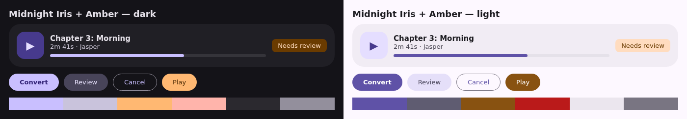

# PDF2Audiobook — Desktop App (Tauri) Specification

**Status:** Draft; owner decisions settled 2026-11-14 (§14)
**Date:** 2026-11-14
**Branch:** `tauri`, from master at 05ca4c37685325ced177cf06d21de2506fe18cd2 (tag `v0.1.0`)
**Parent specification:** `docs/PDF2AUDIOBOOK_SPEC.md` (contracts, privacy rules, §12 engineering principles)
**Companion:** `docs/PDF2AUDIOBOOK_TAURI_TODO.md`

## 1. Purpose and scope

pdf2audiobook is a command-line tool, which keeps it out of reach of people who don't use a
terminal. This work adds a desktop app built with [Tauri 2](https://tauri.app) that covers the
same workflow as the README walkthrough: check the setup, add a book, analyze it, review the
chapters, approve LLM edits, convert, listen, and package an M4B.

**The Python CLI stays the engine.** The app runs `pdf2audiobook` commands as a child process
and reads their `--json` output and the workspace files. It never reimplements analysis,
chapter planning, synthesis or the manifest format. Everything the app can do, the CLI can
still do, and the CLI's contracts (privacy, approvals, resume, fail-closed budgets) apply
unchanged.

| ID | Area | Summary |
| --- | --- | --- |
| D1 | Repository layout and toolchain | A `desktop/` project beside the Python package |
| D2 | CLI contract additions | The few machine-readable outputs the app needs and the CLI lacks |
| D3 | Engine bridge (Rust) | Locating the CLI, running commands, cancelling, parsing results |
| D4 | Screens and workflow | The screens and the order the user moves through them |
| D5 | Progress and long runs | Live progress, time estimates, cancel and resume |
| D6 | Chapter review | Reusing the existing review page inside the app |
| D7 | Listening and output | Playing chapters, packaging M4B, exporting |
| D8 | Security and privacy | Tauri capabilities, CSP, file scope, content-free logs |
| D9 | Testing | Rust, frontend, CLI contract and end-to-end tests |
| D10 | Packaging and CI | Installers, signing, and the CI jobs that build and test the app |
| D11 | Visual design | Material 3 components, the Midnight Iris palette, theme, type, layout and motion |

**Out of scope for this round:** reimplementing any pipeline step in Rust or TypeScript; a
native chapter editor that merges or splits chapters (the review page can only retitle and
move boundaries, §6); mobile targets; a remote or multi-user server; auto-update; bundling
Ollama, FFmpeg or Tesseract; any change to analysis or audio output.

## 2. Ground rules

- **The CLI is the only engine.** The app calls `pdf2audiobook` with arguments it builds from
  a fixed list; it never passes user text through a shell, and never edits `manifest.json`,
  chapter files or the budget ledger directly. Changes go through CLI commands (`review`,
  `edits`, `regenerate-chapter`, `recover`).
- **Machine-readable only.** The app reads stdout JSON, stderr JSON errors (`--json`), and the
  documented workspace files (`reports/run_status.json`, `manifest.json` via `inspect --json`).
  It never parses human-mode text or Rich output. A field the app needs that isn't in a
  machine-readable output is added to the CLI first (D2), with a contract test.
- **Same privacy rules as the CLI.** The app's own logs, errors and crash reports hold no book
  text, titles, file names or private paths. Book content stays on the machine unless the user
  turns on a remote LLM, with the same `--allow-remote-content` consent the CLI needs.
- **Approvals stay with the user.** The app never accepts a review reason, approves chapters or
  accepts LLM edits on the user's behalf; each needs an explicit click on a screen that shows
  what is being approved.
- **The CLI is unchanged for CLI users.** D2 additions are additive: no existing flag, output
  field, exit code or file format changes meaning.
- **Each commit passes its checks:** `/verify` for Python changes; `cargo fmt --check`,
  `cargo clippy -- -D warnings`, `cargo test`, and the frontend lint, type-check and tests for
  `desktop/` changes.

## 3. D1 — Repository layout and toolchain

- **D1.a** The app lives in `desktop/`: `desktop/src-tauri/` (Rust, Tauri 2) and
  `desktop/src/` (frontend). Nothing under `src/pdf2audiobook/` depends on it, and the Python
  wheel and sdist don't include it.
- **D1.b** Frontend: React and TypeScript with Vite, using Google's Material 3 (D11).
- **D1.c** Versions are pinned: `rust-toolchain.toml` for Rust, `package-lock.json` with an
  exact Node version in `.nvmrc` (Node 22, matching CI), and `Cargo.lock` committed.
- **D1.d** The app version matches `pyproject.toml` (`0.1.0`). A test fails if
  `tauri.conf.json`, `Cargo.toml`, `package.json` and `pyproject.toml` disagree.
- **D1.e** `desktop/README.md` explains how to install the toolchain, run the app in
  development mode (`npm run tauri dev`), run every check, and build an installer. The main
  README links to it.

## 4. D2 — CLI contract additions

Each addition is additive, has `--json` output on stdout, and has a Python contract test that
pins the exact JSON keys. The app depends only on these documented shapes.

- **D2.a Workspace location before a run.** A new command,
  `pdf2audiobook workspace BOOK [--output DIR] --json`, prints
  `{"workspace": "<path>", "exists": true|false}`. It uses the same rule as analysis
  (`<output_dir>/<stem>-<first 10 hex of SHA-256>`; `pipeline._analysis_workspace_folder`),
  so the app can watch `reports/run_status.json` from the start of a run instead of computing
  the hash itself. It reads the file but writes nothing.
- **D2.b Stable error reasons.** JSON errors gain an optional `"reason"` string next to
  `type`, `code` and `message`, for the failures the app must act on rather than just show:

  | reason | When | App action |
  | --- | --- | --- |
  | `review_required` | Conversion refuses because a chapter boundary needs review | Open the review screen |
  | `review_acknowledgement_required` | A book-wide review reason (`damaged_source`, `ambiguous_page_numbers`) blocks conversion | Show the reason and an explicit acknowledge button |
  | `workspace_locked` | Another run holds the workspace | Offer to wait or cancel |
  | `pending_recovery` | A previous update needs `recover` | Offer recovery |
  | `chapter_conflict` | An edited chapter file conflicts | Offer `regenerate-chapter` with a backup |
  | `llm_unreachable` | The LLM server can't be reached | Link to the LLM settings |
  | `llm_context_too_small` | The served context is too small | Explain `num_ctx` and the context setting |
  | `llm_output_cap` | An answer hit the output cap | Suggest a larger output cap |
  | `budget_exhausted` | A configured LLM budget is reached | Show the budget screen |

  Existing `type`, `code` and `message` values don't change. A test runs each failure and
  checks its `reason`.
- **D2.c Review server address.** With `--json`, `review` prints one JSON line to stdout once
  the server is listening, `{"url": "http://127.0.0.1:<port>/", "port": <port>}`, and flushes
  it. `--port 0` picks a free port. Human mode is unchanged.
- **D2.d Clean termination.** SIGTERM is handled like Ctrl+C: the run stops at the next safe
  point, writes `run_status.json` with `"state": "stopped"`, releases the workspace lock and
  exits 130 with the `Interrupted` JSON error. On Windows, the app's cancel uses
  `CTRL_BREAK_EVENT` to the child's process group, and the CLI treats it the same way.
- **D2.e Voices.** `pdf2audiobook voices [--tts-provider kitten|piper] [--tts-model M] --json`
  lists the voice names the selected provider accepts (`KittenProvider.list_voices`), so the
  app never hard-codes them.
- **D2.f `--version` on its own.** `pdf2audiobook --version` currently exits 2 with "Missing
  command" unless another command follows it (found while writing this spec, on master at the
  baseline). It must print the version and exit 0 on its own; a test runs it with no command.
- **D2.g Book thumbnail.** `pdf2audiobook thumbnail BOOK --output FILE.png [--width N] --json`
  renders the first page of a PDF (or the cover of an EPUB) to a PNG at the given path and
  prints `{"thumbnail": "<path>", "width": N, "height": N}`. It writes nothing else. The app
  keeps thumbnails in its own cache folder, which holds book images and is treated like the
  workspace for privacy.

## 5. D3 — Engine bridge (Rust)

- **D3.a Locating the CLI.** In order: the path saved in the app's settings; `pdf2audiobook` on
  `PATH`; `uv run --project <path> pdf2audiobook` when the user points at a source checkout.
  The app runs `--version` and `doctor --json` to confirm it, and refuses a CLI whose version
  doesn't match the app's major and minor version.
- **D3.b Running commands.** A Rust module builds each command from a typed request (one enum
  variant per supported command and option) into an argument vector, and starts it with
  `std::process::Command` (or Tauri's shell plugin with a fixed scope, §10). No shell, no
  string concatenation, no user-supplied flags. Every run gets `--json` and `--no-progress`.
- **D3.c Results.** Exit 0 parses stdout as the command's JSON result. Any other exit parses the
  last stderr JSON object as `{ok:false, error:{type, code, message, reason?}, warnings}`. If
  neither parses, the app shows a fixed "The engine returned an unreadable result" message with
  the exit code only.
- **D3.d One run per book.** The bridge allows at most one write-capable command per
  workspace (analyze, convert, review save, edits, regenerate, recover, pack). The CLI's own
  lock remains the authority; the bridge's check only avoids starting a run that will be
  refused.
- **D3.e Environment.** The child inherits the user's environment, so `PDF2AUDIOBOOK_*`
  settings and the config file keep working. The app never sets a PDF password itself; for an
  encrypted PDF it asks for the name of an environment variable, as the CLI does.

## 6. D4 — Screens and workflow

The screens follow the README walkthrough. Every screen works with the keyboard and a screen
reader, and shows the command it runs in a "Details" disclosure so users can repeat it in a
terminal.

1. **Setup** (first launch, and from Settings): runs `doctor --json` and shows FFmpeg,
   Tesseract and its languages, Kitten, Piper, and the LLM provider. For Ollama it also shows
   whether the configured model's served context is large enough, and how to fix it (the README
   "Using a local LLM" steps). Missing pieces show the exact install command.
2. **Library**: the books in the output folder, each with its title (from `inspect --json`),
   chapter count, state (not analyzed, needs review, ready, converting, converted, failed), and
   last run time. "Add book" opens a file dialog for PDF or EPUB.
3. **Book options**: LLM on or off, model, context and output caps, voice (from D2.e), speed,
   chapter range, cover image, and remote-content consent when a remote provider is chosen.
   The choices become CLI flags; nothing else is stored per book by the app.
4. **Run**: live progress for analyze or convert (§7), with cancel.
5. **Review**: the chapter review page (§8). Appears automatically when a run stops with
   `review_required` or `review_acknowledgement_required`.
6. **Pending edits**: `edits list --json` as a table of original and proposed text, with accept
   and reject per edit and "accept all" behind a confirmation. Applying runs `edits accept` or
   `edits reject`.
7. **Chapters and audio**: each chapter's title, length and audio state, an audio player, "open
   folder", "make M4B" and "export zip" (§9).
8. **Settings**: CLI location, output folder, default voice with the README voice samples, and
   LLM provider settings. The app writes only its own settings file; it shows the effective
   CLI configuration (`config show --sources --json`) read-only and explains where to change
   it.

## 7. D5 — Progress and long runs

- **D5.a** Before a run, the app gets the workspace from D2.a and polls
  `reports/run_status.json` about once a second. It shows the stage name, done and total, the
  unit, elapsed time and the estimate, all of which the file already holds.
- **D5.b** A run is finished when the child exits. The app then reads the result (D3.c); a
  `run_status.json` left at `running` after the child exits is shown as "stopped".
- **D5.c** Cancel sends the D2.d termination signal, waits up to 30 seconds, then kills the
  child and offers `recover` if the next command reports `pending_recovery`.
- **D5.d** Closing the window during a run asks for confirmation and then cancels cleanly. The
  app never leaves a child process running after it exits.
- **D5.e** Resuming is the CLI's: running convert again reuses finished chapters. The app
  says so on the button ("Continue converting").

## 8. D6 — Chapter review

- **D6.a** The app starts `review --json --port 0` (D2.c) and shows the returned URL in a
  dedicated webview window. The review page, its token and its validation stay exactly as
  they are; the app adds nothing to the page.
- **D6.b** Closing the review window stops the review server, then re-reads the book's state.
- **D6.c** Merging or splitting chapters isn't possible in the review page. The app says so
  and links to the README section on editing the manifest; it doesn't edit the manifest
  itself.

## 9. D7 — Listening and output

- **D7.a** Chapter MP3s play in the app with an HTML `<audio>` element, through Tauri's asset
  protocol scoped to the book's `audio/` folder.
- **D7.b** "Make M4B" runs `pack-m4b --json` with an output path the user picks, and a cover
  if one is set.
- **D7.c** "Export zip" writes the chapter MP3s and, if the user ticks it, the source book, as
  in this session's manual export. The zip is written to a path the user picks, never inside
  the workspace.

## 10. D8 — Security and privacy

- **D8.a Capabilities.** Tauri capabilities allow only: the dialog plugin (open and save), the
  bridge's own commands, and the asset protocol for the current book's `audio/` folder. No
  general filesystem, shell, HTTP or opener access is exposed to the frontend.
- **D8.b CSP.** The main window's Content Security Policy allows only the app's own scripts
  and styles; no remote origins and no `unsafe-eval`. The review window loads only
  `http://127.0.0.1:<port>/` from D2.c.
- **D8.c Logs.** The app's log holds event names, exit codes and durations only, like the
  CLI's events. A test feeds a book whose title, file name and text contain marker strings and
  checks that none appears in the app's log or error dialogs.
- **D8.d No network of its own.** The app makes no network requests. Network use (Ollama,
  OpenAI, Hugging Face model downloads) happens only inside the CLI, under its existing rules.

## 11. D9 — Testing

- **D9.a Rust:** unit tests for argument building (every request variant), result parsing
  (success, each `reason`, unreadable output), CLI location and version check, and the
  one-run-per-book rule. The process runner is behind a trait so tests use a fake CLI.
- **D9.b Frontend:** component tests (Vitest and Testing Library) for each screen's states,
  including every D2.b reason.
- **D9.c CLI contracts:** Python tests pin the JSON shape of every output the app reads:
  `doctor`, `inspect`, `analyze`, `convert`, `edits list`, `pack-m4b`, `config show`, `review`
  (D2.c), `workspace` (D2.a), `voices` (D2.e), the error object with `reason` (D2.b), and
  `thumbnail` (D2.g) and `run_status.json`. A shared JSON Schema file in `desktop/contracts/` is the single source; the
  Rust parser tests and the Python tests both validate against it.
- **D9.d End to end:** on Linux CI, a WebDriver test (`tauri-driver`) runs the walkthrough on
  the README demo book (`scripts/readme_screenshots/make_demo_pdf.py`) with `--no-llm`: add
  book, analyze, review (retitle chapter 1 and save), and convert with `--dry-run`. Real Kitten
  synthesis stays an opt-in local test, as in the CLI.

## 12. D10 — Packaging and CI

- **D10.a** The first release requires the CLI to be installed separately (owner decision O1).
  The installer is the Tauri app only; the Setup screen explains how to install the CLI with
  `uv tool install` from a source checkout (`uv tool install ".[kitten]"`, run in the checkout)
  or how to point the app at a checkout run with `uv run`.
- **D10.b** Installers: AppImage and `.deb` for Linux now (O2). macOS (`.dmg`) and Windows
  (`.msi`) come later.
- **D10.c** A CI job on the `tauri` branch and on pull requests runs `cargo fmt --check`,
  `cargo clippy`, `cargo test`, the frontend checks and a Linux `tauri build`. The existing
  Python CI also runs for pull requests from this branch. CI needs no network beyond package
  installs.
- **D10.d** Signing and notarization are owner decisions (O4); unsigned builds are labelled as
  such in their file names.

## 13. D11 — Visual design

The app should look polished, modern and professional, built on Google's
[Material 3](https://m3.material.io) design system.

- **D11.a Components.** Use Google's `@material/web` (Material 3 web components; React 19 uses
  custom elements directly) for the components it provides: buttons, icon buttons, FABs,
  text fields, selects, chips, checkboxes, radios, switches, sliders, dialogs, lists, menus,
  tabs and progress indicators. It has no navigation rail, top app bar, snackbar or stable
  card, so build those as React components that use only the same `--md-sys-*` design tokens.
  No second component library.
- **D11.b Color.** The palette is **Midnight Iris with Amber**: primary seed `#6D5BD0` (iris
  violet), tertiary seed `#E8A25C` (amber), and neutrals tinted with the primary hue. The full
  Material 3 scheme is generated from the seeds with `@material/material-color-utilities` at
  build time, never typed in by hand. The key roles:

  | Role | Dark (default) | Light |
  | --- | --- | --- |
  | `primary` | `#c9bfff` | `#5f52a7` |
  | `onPrimary` | `#302175` | `#ffffff` |
  | `primaryContainer` | `#473a8d` | `#e5deff` |
  | `onPrimaryContainer` | `#e5deff` | `#473a8d` |
  | `secondary` | `#c9c3dc` | `#5f5c71` |
  | `secondaryContainer` | `#484459` | `#e5dff9` |
  | `onSecondaryContainer` | `#e5dff9` | `#484459` |
  | `tertiary` | `#ffb872` | `#885211` |
  | `onTertiary` | `#4a2800` | `#ffffff` |
  | `tertiaryContainer` | `#6a3b00` | `#ffdcbf` |
  | `onTertiaryContainer` | `#ffdcbf` | `#6a3b00` |
  | `error` | `#ffb4ab` | `#ba1a1a` |
  | `errorContainer` | `#93000a` | `#ffdad6` |
  | `surface` | `#141318` | `#fdf8ff` |
  | `surfaceContainerLow` | `#1c1b20` | `#f7f2fa` |
  | `surfaceContainer` | `#201f25` | `#f1ecf4` |
  | `surfaceContainerHigh` | `#2b292f` | `#ebe6ee` |
  | `surfaceContainerHighest` | `#35343a` | `#e5e1e9` |
  | `onSurface` | `#e5e1e9` | `#1c1b20` |
  | `onSurfaceVariant` | `#c9c4d3` | `#484551` |
  | `outline` | `#938f9c` | `#797582` |
  | `outlineVariant` | `#484551` | `#c9c4d3` |

  

  How the roles are used: **primary** for the main action on each screen (Convert, Analyze)
  and progress; **tertiary amber** for things that need the user (needs review, pending
  edits) and for audio playback; **error** only for failures. Containers carry chips and
  status badges; the surface-container steps give depth instead of shadows.
- **D11.c Theme.** Dark is the default (people often listen in the evening). Light and "follow
  the system" are offered in Settings. Every text and icon pairing meets WCAG AA contrast (4.5:1
  for text, 3:1 for large text and icons); a test computes the ratios from the generated scheme.
- **D11.d Type and shape.** Material 3 type scale with Roboto Flex for the interface and Roboto
  Mono for chapter text previews, bundled with the app (no font downloads at run time).
  Material 3 shape scale: large (16 px) corners for cards, extra-large (28 px) for dialogs,
  full rounding for buttons and chips.
- **D11.e Layout.** A navigation rail on the left (Library, Run, Settings) and a content area
  of cards. The library is a grid of book cards with the PDF's first page as a thumbnail, the
  title, chapter count and a status chip. A persistent bottom player bar appears once any
  chapter is playing. The window works from 960×600 up; below 1200 px wide the grid drops to
  fewer columns rather than shrinking cards.
- **D11.f Motion.** Material 3 easing and durations for page changes, card expansion and the
  player bar; progress uses the Material linear and circular indicators. Everything respects
  the system's reduced-motion setting.
- **D11.g Icons.** Material Symbols (Rounded), bundled as a subset font; no icon downloads at
  run time.
- **D11.h Review.** Before a screen counts as done, its screenshots in dark and light mode
  are attached to its TODO item, and the owner reviews the first two screens (Setup and
  Library) before the rest are built.
- **D11.i Accent buttons.** At the owner's request (2026-11-14, after reviewing the first two
  screens), the main actions are more striking than stock Material 3: filled buttons and the FAB
  carry a gradient from `primary` to amber `tertiary` (dark themes) or to `onPrimaryContainer`
  (light themes, where an amber dark enough for white text turns brown), a glossy top edge, a
  coloured glow, and on hover a light sheen that sweeps across, a 2 px lift, a warmer glow and a
  faint ring; a slight press-in on click. The FAB is 64 px tall with 20 px corners. Tonal buttons
  get an iris-to-amber gradient outline, an amber icon and an amber glow on hover. Labels stay
  `onPrimary`; the contrast test checks both gradient ends in both themes (the sheen is a
  passing highlight). Material's own state layers, ripple and focus ring are kept, and reduced
  motion turns the movement off.

## 14. Owner decisions

All five were decided by the owner on 2026-11-14:

- **O1 Python runtime: require an installed CLI.** The installer is the Tauri app only.
  Bundling Python was ruled out for now by size: with the `kitten` extra the environment is
  6.1 GB (PyTorch 1.1 GB, NVIDIA libraries 3.2 GB, Triton 0.9 GB), although the default
  `mini` voice is an ONNX model that needs only `onnxruntime` (63 MB). Bundling would first
  need a slimmer Kitten dependency set.
- **O2 Platforms: Linux only for now.** macOS and Windows come later.
- **O3 UI: React and TypeScript, with Google's Material 3** (D11).
- **O4 Signing: unsigned builds for now.**
- **O5 CI: add the `tauri` branch to the `ci.yml` push triggers.**

## 15. Risks

- **Engine and app drift.** Mitigated by D9.c: one JSON Schema checked from both sides.
- **Long LLM runs.** A book can take hours; D5 depends on `run_status.json` staying current,
  which the CLI already refreshes every few seconds.
- **Cancelling on Windows.** Process-group signalling differs; D2.d needs a Windows test before
  Windows is a supported platform.
- **Webview differences.** The review page is plain HTML and should work in WebKitGTK,
  WebKit and WebView2, but D9.d tests only Linux.
- **`@material/web` is in maintenance mode.** Its README says it is "in maintenance mode
  pending new maintainers", so it will get few fixes and no new components. Pin its version;
  keep every use behind small React wrapper components so a replacement touches only the
  wrappers.
