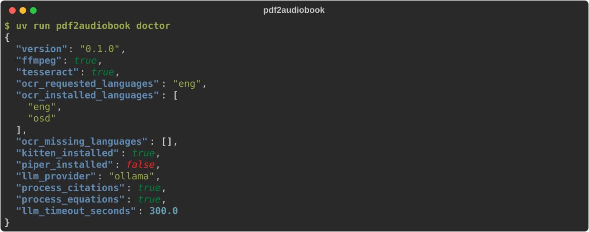
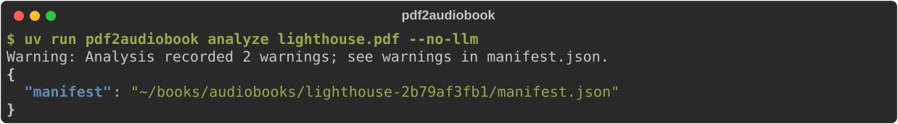
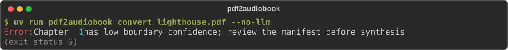
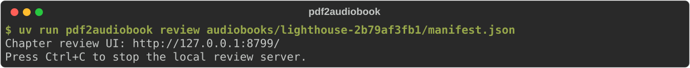
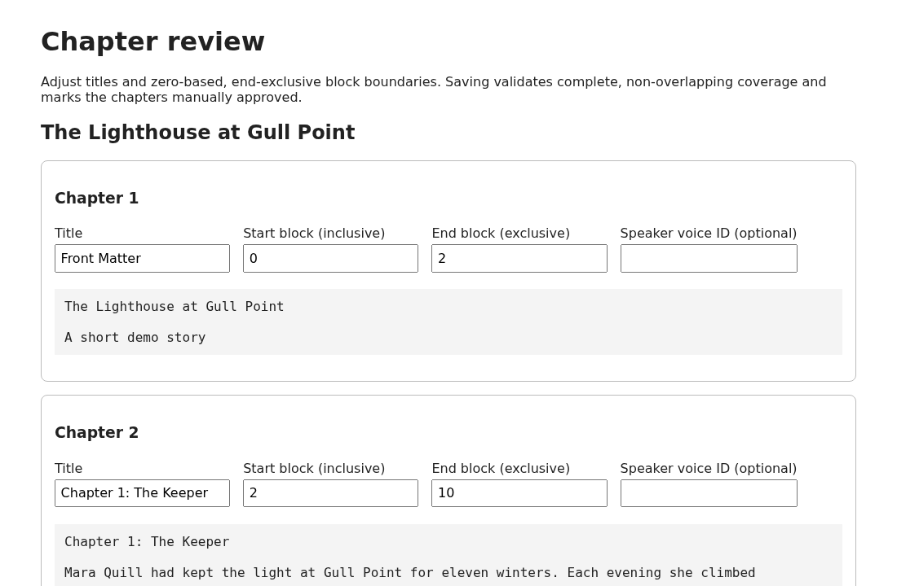
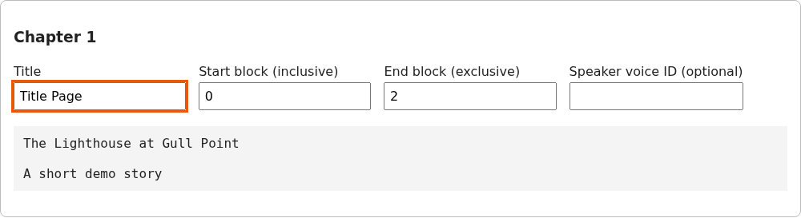
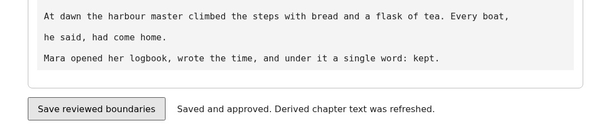
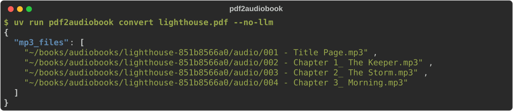
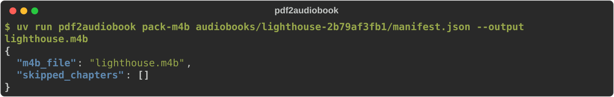

# Installation and first audiobook

[Home](../../README.md) · [All guides](README.md)

Install the CLI, then follow the illustrated walkthrough. Commands assume you are in the
repository root.

- [Requirements](#requirements)
- [Installation](#installation)
- [Walkthrough: from PDF to audiobook](#walkthrough-from-pdf-to-audiobook)
- [Desktop app](#desktop-app)

## Requirements

| What | Needed for | Notes |
|---|---|---|
| [uv](https://docs.astral.sh/uv/) and Python 3.11+ | Everything | uv installs Python and manages `.venv` for you. CI tests 3.11, 3.12 and 3.13. |
| FFmpeg | Making MP3 and M4B files | Install with your OS package manager, for example `sudo apt install ffmpeg`. |
| Tesseract (`eng` pack) | Scanned pages (OCR) | For example `sudo apt install tesseract-ocr tesseract-ocr-eng`. Text PDFs don't need it. |
| Kitten TTS | The default voice | A Python extra: `uv sync --extra kitten`. The first conversion downloads the model. |
| Ollama | Optional LLM assistance | Not needed with `--no-llm`. See [Using a local LLM](llm.md#using-a-local-llm-ollama). |
| Node 22 | A few page-script tests | Those tests skip when `node` isn't installed. |
| Desktop app | Building or running the desktop app | Rust, Node 22 and Tauri's Linux libraries. See [desktop/README.md](../../desktop/README.md). |

Piper is an alternative voice that you install separately; see [Voices and
speech](voices.md#voices-and-speech).

## Installation

~~~bash
git clone <this repository> pdf2audiobook
cd pdf2audiobook
uv python install 3.11
uv sync --locked --extra kitten --extra dev   # app, voice model support and dev tools
uv run pdf2audiobook doctor                   # checks FFmpeg, Tesseract, Kitten and the LLM settings
~~~

`uv sync` creates and manages `.venv` automatically; run everything through `uv run` and never
install into the system Python. If you don't need real speech (for example, to work only on
analysis code), `uv sync --locked --extra dev` is enough and much smaller: the tests mock the
voice. The `kitten` extra pulls in a large model stack and downloads the voice model on first use.

The committed `uv.lock` pins default, `dev`, and optional `kitten` dependencies. Use
`uv sync --locked --extra dev` for development without speech models. CI checks the lockfile
and installs that environment on Python 3.11, 3.12 and 3.13; real Kitten synthesis remains
an opt-in acceptance check. See [development and validation](development.md) for checks and
dependency changes.

Note that `uv sync --locked --extra dev` *removes* the Kitten packages if they were installed;
add `--extra kitten` again before converting a book.

To save voices, output paths or other recurring settings, follow
[configuration setup](configuration.md). It includes a starter TOML file and validation steps.

## Walkthrough: from PDF to audiobook

Use your own PDF in place of `lighthouse.pdf`, and use the workspace path printed by analysis
in the review and packaging commands. The screenshots use a generated demo book.

This example converts a short four-page demo book, `lighthouse.pdf`, without an LLM. Every
screenshot is real output from the commands shown; to regenerate them after the output
changes, run [scripts/readme_screenshots/run.sh](../../scripts/readme_screenshots/run.sh)
(its header lists what it needs). Book workspaces are created under
`./audiobooks/` in the folder you run from; each book gets its own folder, named after the file
plus a short hash.

### Step 1: Check your setup

~~~bash
uv run pdf2audiobook doctor
~~~

Check that `ffmpeg` and `kitten_installed` are `true`, and that no OCR language is missing. If
Kitten shows `false`, run `uv sync --extra kitten --extra dev`.

### Step 2: Analyze the book

~~~bash
uv run pdf2audiobook analyze lighthouse.pdf --no-llm
~~~

Analysis extracts the text and writes a workspace with `manifest.json` (the chapters, the source
text and every warning) and one editable text file per chapter in `chapters/`. It makes no audio.
You can skip this step and go straight to `convert`, which analyzes first if needed.

### Step 3: Convert, and see why it stops

~~~bash
uv run pdf2audiobook convert lighthouse.pdf --no-llm
~~~

Conversion refuses to make audio while any chapter boundary is uncertain. Here the title page
became a "Front Matter" chapter with low confidence, so the run stops with exit status 6 and
asks you to review. Nothing has been synthesized yet.

### Step 4: Review the chapters in your browser

~~~bash
uv run pdf2audiobook review audiobooks/lighthouse-2b79af3fb1/manifest.json
~~~

Open the printed address. The page lists every chapter with its title, its block range and a
preview of its text:

Fix what is wrong. Here chapter 1 only holds the title page, so give it a better title. You can
also move a chapter's start and end block (blocks are numbered from 0, and the end is
exclusive), or set a different voice for a chapter:

Scroll to the bottom and click **Save reviewed boundaries**. Saving checks that the chapters
cover every block exactly once with no overlap, marks them all as manually approved, and
rewrites the chapter text files:

Press Ctrl+C in the terminal to stop the review server. The server listens only on
`127.0.0.1` and uses a fresh access token each run.

The review page can retitle chapters and move boundaries, but it can't add or remove chapters.
To merge or split chapters, edit the `chapters` list in `manifest.json` (keep a backup), then
see [Protecting manual edits](editing-and-review.md#protecting-manual-edits).

### Step 5: Convert again

~~~bash
uv run pdf2audiobook convert lighthouse.pdf --no-llm
~~~

The analysis is reused, and each chapter becomes a tagged MP3 in the workspace's `audio/`
folder. A long book shows a progress bar with a time estimate in an interactive terminal (see
[Progress and time estimates](cli.md#progress-and-time-estimates)). If a run is interrupted, run the
same command again: finished chapters are kept.

### Step 6: Package as one M4B (optional)

~~~bash
uv run pdf2audiobook pack-m4b audiobooks/lighthouse-2b79af3fb1/manifest.json --output lighthouse.m4b
~~~

The M4B holds all chapters with chapter markers, which most audiobook players show as a
chapter list. Add `--cover cover.jpg` for artwork.

### What to check before you share an audiobook

Chapter detection, tables and figures are still the weak spots, especially in technical papers.
Before you share the files, read `chapters/*.txt` or listen to the chapters, and check the
warnings in `manifest.json`: tables are read cell by cell, and words drawn inside figures can
appear as loose words. Put such material in its own chapter at review time, so listeners can
skip it.

## Desktop app

The desktop app (Tauri 2, React and TypeScript) lives in [`desktop/`](../../desktop/README.md). It
runs
this CLI, so the CLI must be installed first. It is in development and Linux-only for now.

~~~bash
uv tool install ".[kitten]"              # the CLI the app runs (from the repository root)
cd desktop
npm ci && npm run tauri dev              # start the app with hot reload
npm run tauri build -- --bundles appimage   # AppImage; use --bundles deb for a .deb
~~~

Install Tauri's Linux libraries, Rust, Node 22 and the GStreamer plugins before building; the
[desktop README](../../desktop/README.md#requirements) lists the exact packages. The AppImage needs
the
GStreamer plugins to play audio, so [building an
installer](../../desktop/README.md#building-an-installer)
explains what to install first. The desktop README also covers the checks, the end-to-end
walkthrough and the security notes.
